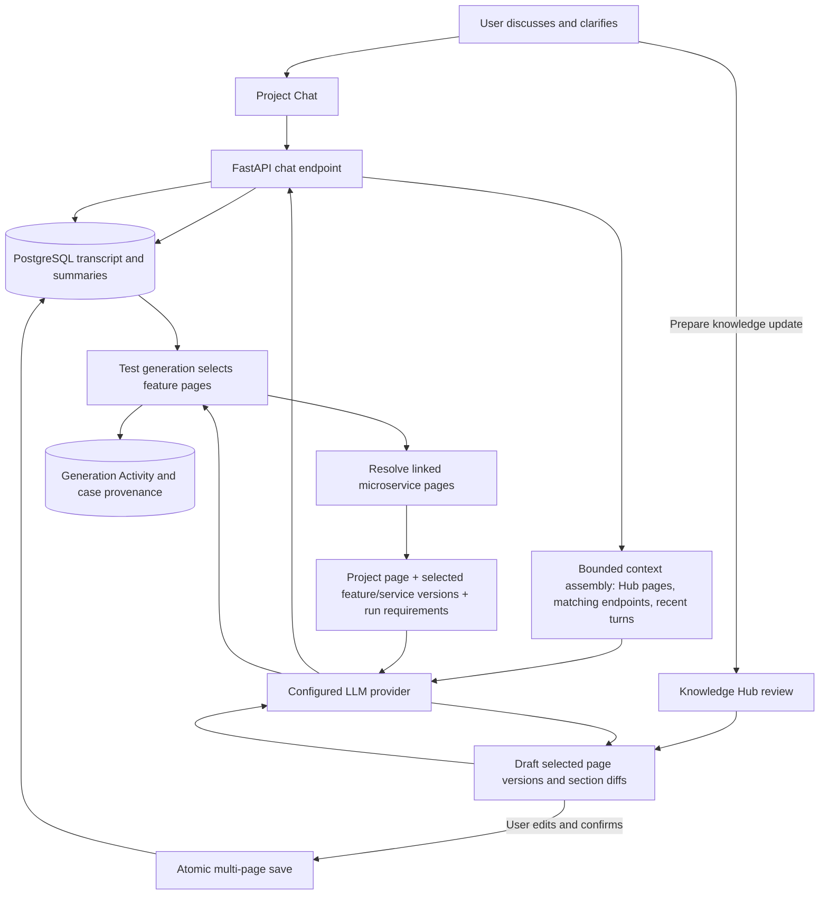

# Project Chat and Knowledge Hub

Api-Agent keeps project conversations and approved product knowledge in PostgreSQL. LLM requests use the shared provider order configured by `LLM_PROVIDER_ORDER` (AMD Token Lab first by default), rather than provider-owned conversation threads. The backend stores the transcript, summarizes older turns, and assembles bounded context for each chat request. A chat message is only a conversation turn. It does not run knowledge extraction or change saved Hub pages.

## User workflow

1. Select a project and open **Project Chat**. Start or reopen a conversation and discuss product behavior, workflows, integrations, and open questions. Ask the assistant to summarize the current understanding or clarify uncertainties as part of the discussion.
2. Open **Knowledge Hub** to create or select pages. The project-wide page stores shared rules. Feature pages hold product capabilities and journeys. Microservice pages hold reusable service behavior and integration details.
3. Link each feature to its microservices. A feature can link to several microservices, and one microservice can be reused by several features.
4. Return to the conversation, select one or more destination pages, and choose **Prepare knowledge update**. The model prepares an unsaved full-page draft and a section-level diff for each page using the selected thread and the current page contents.
5. Review and edit every draft. Added and removed lines appear in a GitHub-style diff; use the **Edit** and **Preview** tabs to update the Markdown and inspect its rendered form. Confirmed rules may be saved while uncertainties remain in a clearly labeled **Open questions** section. Select which drafted pages to include, then save them together as new immutable versions. Drafting alone does not change the Hub. The current page preview and proposed changes use separate scroll areas.
6. Inspect each page's version history to read prior contents and compare each version with the preceding version. Restoring old content creates a new version; earlier versions remain unchanged.
7. In Test Cases, the project-wide page is always included. Select feature pages relevant to the generation; their linked microservice pages are added automatically. Enter **Business requirements for this generation** for action-specific guidance. That field is saved with the generation and cases but never updates Hub pages.

## Data and provenance

| Information | Durable storage and behavior |
| --- | --- |
| Chat threads and ordered messages | `project_chat_threads` and `project_chat_messages`; full transcripts and rolling summaries remain in PostgreSQL. |
| Hub pages | Existing `project_brief_scopes` rows represent project, feature, and microservice pages. Legacy scopes remain preserved but are hidden from current Hub selection. |
| Page history | `project_brief_versions` stores immutable version content, version number, current marker, source thread, and timestamp. A multi-page save appends every selected version in one database transaction. |
| Feature/service relationships | `knowledge_hub_feature_services` stores project-scoped many-to-many links between feature and microservice pages. |
| Old extraction history | `project_knowledge_submissions`, `project_knowledge_facts`, `project_knowledge_questions`, and `project_knowledge_events` remain available. Existing extraction events are history; chat turns no longer create new submissions or extraction events. |
| Generation provenance | Generation Activity and generated case payloads retain the exact version IDs, numbers, names, and content used, alongside run-specific requirements, selected endpoints, prompt, and LLM response. |

The app does not use the full chat transcript as durable generation context. Chat uses relevant Hub page snapshots, saved endpoint matches, a rolling summary, recent turns, and the new message within its context budget. A knowledge update draft uses the selected thread's saved transcript and summary, the current destination page, and the configured drafting budget. Generation uses the current project-wide page, explicitly selected feature pages, and linked microservice pages. Open questions are text in those pages and are presented to the model as unresolved context.

## Migration and compatibility

Startup performs an additive, idempotent migration. Existing project, feature, and microservice brief versions remain in their original version history and become the corresponding Hub pages. Existing per-thread legacy briefs are retained and their current content is copied into the project-wide page with a source label. Active approved or assumed facts are appended to a new current page version with their fact ID and source submission ID. The original fact rows, submissions, and extraction events are not deleted or rewritten. Unapproved proposals and legacy mutable entries are not copied into active Hub context.

Old brief API routes remain for compatibility with existing stored activity and clients. The current interface uses Knowledge Hub routes and no longer offers a separate brief editor or automatic per-message extraction. **Activity Logs → Knowledge Extraction** combines historical extraction events with Hub page creation, feature-service link changes, draft successes/failures, page saves, and restores. Draft details retain the exact prompt, raw response, provider/model, source thread, and destination page. Save/restore details retain the version and content. The table loads paged summaries and fetches prompt/response bodies only when a user opens a record. Normal chat turns do not create extraction events.

## API surface

- `GET /api/v1/projects/{project_id}/knowledge-hub/pages` lists current project, feature, and microservice pages and feature links.
- `POST /api/v1/projects/{project_id}/knowledge-hub/pages` creates a feature or microservice page; the project page is created during initialization.
- `PUT /api/v1/projects/{project_id}/knowledge-hub/features/{feature_id}/microservices` replaces a feature's linked microservice IDs. All pages must belong to the same project and have the expected page type.
- `GET /api/v1/projects/{project_id}/knowledge-hub/pages/{scope_id}/versions` returns page history.
- `POST /api/v1/projects/{project_id}/knowledge-hub/pages/{scope_id}/compare` accepts `from_version_id` and `to_version_id` and returns Markdown section diffs.
- `POST /api/v1/projects/{project_id}/knowledge-hub/pages/{scope_id}/versions/{version_id}/restore` appends a new version using the selected historical content.
- `POST /api/v1/projects/{project_id}/chat/threads/{thread_id}/knowledge-draft` accepts `scope_ids` and returns separate draft content and section diffs for each destination. It does not save.
- `POST /api/v1/projects/{project_id}/knowledge-hub/updates` accepts `source_thread_id` and reviewed `{scope_id, content}` page entries; it appends all versions atomically.
- `GET /api/v1/projects/{project_id}/knowledge/activity?limit=25&offset=0` returns paged summaries for historical extraction and Knowledge Hub events without prompt/response bodies.
- `GET /api/v1/projects/{project_id}/knowledge/activity/{event_id}` returns a project-scoped full event, including saved prompts/responses and the source submission for legacy extraction events.

All operations validate project ownership. Chat messages continue to use `POST /api/v1/projects/{project_id}/chat/threads/{thread_id}/messages`; this route stores the exchange and returns without extracting facts.

## Process diagram

## Tradeoffs and limits

- Storing full chat and immutable page versions improves continuity and auditability, while adding PostgreSQL storage and migration complexity.
- Page retrieval reduces unrelated prompt content, but a page can be omitted from chat context if its wording does not match the request. Users choose feature pages explicitly for generation, and linked services are included automatically.
- Configurable provider fallback improves availability, but model behavior and context limits differ by provider. Requests send selected project content to the external provider that answers.
- A model draft is a proposal, not a verified source of truth. The user reviews and saves every page update; unclear facts stay in **Open questions** instead of being silently decided.
- Historical extraction logs can show prompt/response metadata only when those snapshots were recorded. Hub draft logs retain prompt and model response; Hub save and restore logs retain page version content. Normal chat does not create extraction attempts.

## Local database reset

`make docker-db-reset` deletes the current Docker Compose project's PostgreSQL volume after the user types `RESET`, then starts the stack so backend initialization creates the schema and built-in Default Project. This is a destructive local development command; it does not target an arbitrary `DATABASE_URL`. `make docker-down` stops services without deleting database data.
