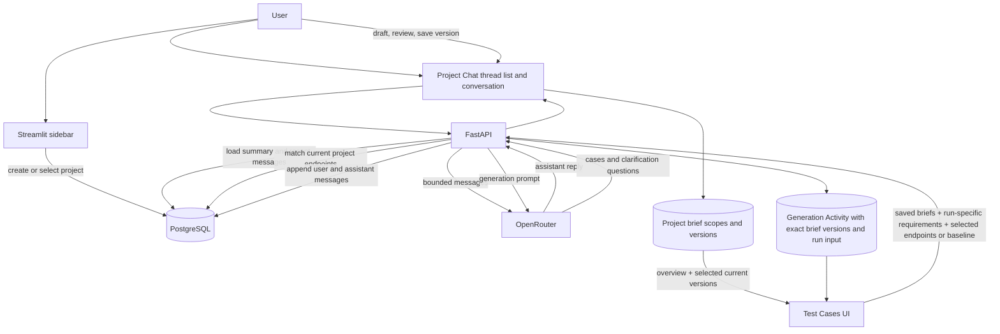

# Persistent Project Chat and Generation Context

## Purpose

Each project has persistent chat threads for discussing product behavior, workflows, integrations, requirements, and endpoint relationships. Api-Agent stores the complete transcript and a rolling summary. OpenRouter receives a bounded subset of project context for each request; it does not retain project memory between calls.

There is no Knowledge Hub UI. Project Chat is where users discuss product behavior and clarify gaps. They can distill confirmed details into versioned briefs: one project overview and any number of feature or microservice scopes. Existing legacy knowledge records are retained but not retrieved by chat or generation.

## Context sources

| Source | Stored in | How it is used |
| --- | --- | --- |
| Conversation messages | Project chat thread and ordered message rows | Full transcript is viewable; recent messages and a rolling summary provide context to future turns in that thread. |
| Saved endpoints | Existing project collections and endpoint records | Chat retrieves a small set of lexical matches across the current project. Generation uses current endpoints selected by the user. |
| Project overview and scoped briefs | Project brief scope and immutable version tables | The overview is always included in generation. Users explicitly select current feature/microservice versions; older versions remain viewable and restorable. |
| Run-specific business requirements | Generation Activity and generated case payloads | Describes this one generation or revision. It is combined with saved briefs but never silently changes them. |
| Generation inputs and output | Generation Activity records | Stores exact brief version IDs and contents, run-specific requirements, endpoint snapshot or revision baseline, prompt, response, and output IDs. |

Brief scopes belong to the project and can be drafted from any active project chat. Thread history remains independent. Only the current version of a selected scope reaches generation; saving a new version does not delete prior versions.

## User workflow

1. Create or select a project in the sidebar. To create one, expand **Project actions**, enter a project name and optional description, and choose **Create project**. The new project becomes active, and its chat threads are project-scoped.
2. In **Project Chat**, choose **New chat** in the compact left thread list. Give the thread a useful topic by writing its first message; the thread is automatically titled from that message. Rename or archive it from its plain **⋯** menu. The thread list and conversation have separate scroll areas.
3. Discuss the feature or release change. Ask the assistant to identify unclear behavior, integration assumptions, endpoint relationships, and unanswered requirements. Correct its assumptions in follow-up messages. The full conversation remains in PostgreSQL.
4. Review the endpoint source references below assistant replies. Chat looks for meaningful exact tokens in endpoint names, URLs, and collection names; it can miss conceptual synonyms. The assistant should ask for clarification when saved endpoint names do not explain the relationship.
5. After the discussion resolves questions and edge cases, open the separate **Project briefs** workspace beside Conversation. Browse **Project overview** and feature/microservice scopes, or create a new scope.
6. Choose **Draft brief from conversation**. The model consolidates the current brief and discussion into a reviewable draft, preserving applicable rules and calling out unresolved contradictions. Edit it and explicitly save it as a new version. The prior version remains available.
7. Open **Test Cases**. The current project overview is included automatically; select one or more feature/microservice briefs. Enter **Business requirements for this generation** for this action's coverage or change request. It is combined with saved briefs and recorded as run-specific text, but it does not update a brief.
8. For a lasting rule change, discuss and clarify it in Project Chat, draft the appropriate scope, and save a new version. For Release Revision, prior requirements and release notes, selected current briefs, and **New requirement changes** remain distinct prompt sections.
9. Generate explicitly. The model receives current selected brief versions and the mode's inputs: run-specific requirements and selected endpoints, or revision baseline and endpoint selection. The full chat transcript is not sent to generation.
10. Review test cases and Generation Activity. The activity records the exact prompt, raw model response, brief version IDs and contents, run-specific text, thread ID, endpoint snapshot, and result metadata.

## What reaches OpenRouter

For a chat turn, the backend assembles:

- System instructions for the project testing assistant.
- The thread's rolling summary and recent transcript messages.
- Up to eight saved endpoint references that match meaningful exact tokens in the message.
- The current user message.

The complete transcript remains app-owned in PostgreSQL. Older messages are summarized as they leave the configured recent-message window; summaries do not delete transcript records. The assembled prompt is bounded approximately by a configurable character budget, while preserving the latest user message. After a successful reply, the chat view returns to the new exchange.

For generation, the backend always resolves the current project overview, then resolves only feature/microservice scopes explicitly selected in the UI. **Business requirements for this generation** is a separate action-specific section. It does not become durable context automatically. When it explicitly changes a saved rule, that change applies to the current run; when the intended change is unclear, the model should ask a clarification question. Release revisions keep prior requirements, previous release notes, current saved briefs, and new requirement changes in separate sections. Activity and case payloads link the exact brief versions used. The full chat transcript is not sent to generation.

## Data-flow diagram

## Process insights and tradeoffs

- **Continuity and auditability:** Threads and full transcripts persist across app reruns and backend restarts. The brief and generation activity preserve the context used for a run.
- **Thread-scoped context:** Separate threads avoid mixing unrelated features. Facts discussed in another thread do not automatically flow into a new thread; users can copy confirmed product-wide rules into the relevant brief.
- **Brief scope and history:** Keep project-wide rules in the overview and service/feature behavior in scoped briefs. A saved update becomes current while previous versions remain available. Generation uses only current versions selected for that run.
- **Run input versus durable rules:** The Test Cases business requirements field is a one-action instruction. Users explicitly promote settled changes by drafting and saving a brief version, avoiding silently turning a test request into product truth.
- **Retrieval limits:** Endpoint matching uses exact lexical tokens and may miss synonyms or relationships described only in product language. The source list makes endpoint matches inspectable.
- **Bounded memory:** Summaries keep older discussions available to the model without resending the full transcript. A summary may omit nuance, so the original conversation remains available for review.
- **Provider limits and privacy:** OpenRouter receives the assembled messages, selected endpoint references, and generation brief. Model context limits, availability, latency, and cost depend on the selected model/provider.
- **Legacy data:** Previously saved Knowledge Hub rows are kept in the database for compatibility but are ignored by chat and generation. No data is deleted by hiding the UI.

## Configuration and API

- `OPENROUTER_API_KEY` is required to send Project Chat messages.
- `OPENROUTER_MODEL` supplies the default model ID for new threads; a thread stores the model used for its replies.
- `PROJECT_CHAT_RECENT_MESSAGES` defaults to `12` recent messages.
- `PROJECT_CHAT_CONTEXT_CHAR_BUDGET` defaults to `24000` approximate characters for the assembled chat context.
- `PROJECT_BRIEF_DRAFT_CHAR_BUDGET` defaults to `48000` approximate total context characters for brief drafting, divided among the current brief, rolling summary, and recent transcript.
- Chat routes: `GET/POST /api/v1/projects/{project_id}/chat/threads`, `GET/PUT /api/v1/projects/{project_id}/chat/threads/{thread_id}`, and `POST /api/v1/projects/{project_id}/chat/threads/{thread_id}/messages`.
- Brief routes list/create project scopes, list/save immutable versions, restore an older version as current, and draft from a project-owned chat thread. Generation accepts `project_brief_scope_ids`; the backend adds the current project overview automatically and validates selected scopes against the project.
