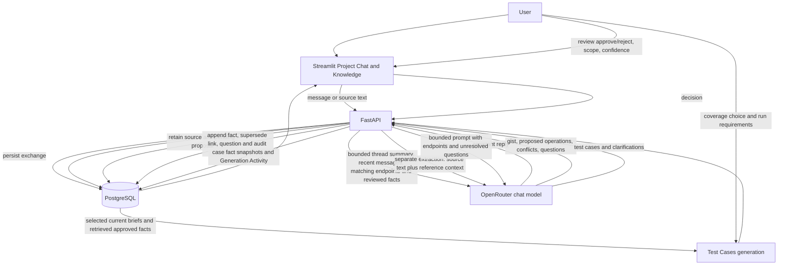

# Persistent Project Chat, Briefs, and Knowledge Ledger

## Purpose and ownership

Api-Agent keeps project knowledge in PostgreSQL. OpenRouter is stateless between calls: each chat or generation request receives a bounded context assembled by Api-Agent. The app retains full chat transcripts, original knowledge submissions, immutable brief versions, stable fact IDs, fact change events, generated cases, and Generation Activity.

The brief and fact ledger serve different purposes. Briefs are user-reviewed, readable documents that capture coherent product/service behavior. The ledger stores smaller source-linked claims and their corrections. A chat response or extraction proposal never changes a brief or activates a fact automatically.

| Context | Durable storage | Use |
| --- | --- | --- |
| Chat transcript and rolling summary | Project chat thread/message tables | Full transcript remains browseable; bounded recent messages and summary support later chat turns. |
| Project overview and feature/service briefs | Brief scopes and immutable version rows | Overview is always included in generation; selected feature and microservice scopes add current versions. |
| Knowledge source submissions | `project_knowledge_submissions` | Original text, source label, gist, proposals, conflicts, extraction state, and chat/question references. |
| Reviewed facts | `project_knowledge_facts` | Stable IDs, scope, confidence, source submission, and optional superseded fact link. Only active confirmed/assumed facts are retrieved. |
| Questions and changes | `project_knowledge_questions` and append-only `project_knowledge_events` | Tracks unresolved questions, answers/dismissal, proposal decisions, and fact corrections. |
| Run-specific requirements and model context | Generated case payloads and Generation Activity | Exact briefs, requirements, endpoint snapshot, coverage choice, fact IDs/snapshots, prompt, response, and result. |

The older mutable `project_knowledge_entries` table remains intact. Existing entries are shown as legacy items for import and review; they are not silently treated as approved facts.

## User workflow

1. Start or reopen a project conversation. Discuss product behavior, user journeys, rules, dependencies, and missing details. Chat answers may cite saved endpoints and previously reviewed facts.
2. After each successful user chat turn, Api-Agent stores the exchange and runs a separate extraction call. The user's message is the only evidence for proposed facts; nearby conversation may resolve a reference such as “that timeout” but cannot support a fact by itself.
3. Open **Knowledge** to review the source, gist, proposed add/update/supersede operations, conflicts, and open questions. Choose a scope (project overview, feature, or microservice) and confidence for each operation. Approve or reject explicitly. Proposals are not generation context until approved.
4. Paste a source or import Markdown/plain text in **Knowledge** to submit product documents, meeting notes, or requirements. New submissions default to the project overview; assign individual proposals to other existing scopes during review.
5. An approved correction marks the prior fact inactive and creates a new fact with a stable ID linked to the old fact. The previous fact and source remain in history. Do not edit old source text to make corrections; submit the corrected statement as new evidence.
6. Review open questions. Submit an answer as another source submission and approve its resulting fact proposals before the question is marked answered. Dismiss a question when it no longer needs resolution. Questions are passed to chat/generation as unresolved context and do not block generation.
7. In **Project briefs**, draft coherent durable behavior from a conversation, review it, and save a new brief version explicitly. Facts and briefs remain separate; ledger approvals never rewrite a brief.
8. In Test Cases, select the project overview (always included) and any relevant current feature/service briefs. Enter run-specific **Business requirements**. Choose **Changed areas** (default) or **Full relevant context** for the fact ledger. The run-specific field guides that action and is not saved as durable knowledge.
9. Generation Activity and each generated case retain the exact fact IDs/snapshots and brief versions used. Release revision additionally carries its baseline, prior requirements/release notes, current endpoint snapshot, and new requirement changes.

If chat extraction returns invalid data or the provider fails, the chat exchange is preserved. The source submission records the extraction failure and can be retried from Knowledge. Pasted/imported extraction behaves the same way.

## Retrieval policy

Knowledge is scoped to the project overview plus feature/service briefs explicitly selected for the generation. Chat can search across project scopes. Retrieval uses PostgreSQL full-text search and a bounded character budget (`PROJECT_KNOWLEDGE_CONTEXT_CHAR_BUDGET`, default 12,000).

- **Changed areas** searches relevant terms and prioritizes matching facts by full-text relevance and recency. If no useful query terms are present, it uses recent current facts.
- **Full relevant context** includes every current confirmed/assumed fact in the selected scopes up to the same budget.
- `needs-clarification` proposals may be approved for tracking, but are not injected as settled facts. Their associated open questions are sent in a clearly labeled unresolved section.
- Rejected proposals, pending proposals, failed extractions, dismissed questions, and legacy entries do not become factual prompt context.
- Retrieved fact IDs and snapshots are stored with generated cases and Generation Activity for audit. Model-produced IDs are not used as provenance.

Chat retrieval also adds lexical matches from current saved endpoints. Both endpoint and knowledge retrieval can miss synonyms or relationships not represented in searchable wording; users can add clarifying text or select full relevant context for generation.

## Data flow

## Process insights and tradeoffs

- **Source traceability:** Every active fact points to a retained submission and proposal; a correction creates a new fact rather than erasing the earlier assertion. This supports review and audit but grows database storage over time.
- **Human approval:** Pending model output cannot affect generation. Review adds a deliberate step, while reducing the risk of assistant guesses becoming product truth.
- **Separate extraction call:** Extracting after each user chat turn gives granular provenance and catches details while the discussion is fresh. It adds latency and OpenRouter usage; extraction failure is isolated from the chat response and can be retried.
- **Scoped retrieval:** Full-text search and explicit brief scopes keep prompts smaller and make context inspectable. Lexical search may miss a relevant fact phrased with different terms; Full relevant context is available when a change spans the scope.
- **Open questions:** Unresolved items are visible to the model but do not stop test generation. The model is instructed to ask rather than assume; users can answer through a new reviewed submission or dismiss the question.
- **Briefs and facts:** Briefs are coherent versioned narratives; facts are individually reviewable evidence. This avoids silently rewriting a business brief when a single fact changes, at the cost of maintaining both views.
- **Provider and privacy:** The full database is not sent to OpenRouter. Each call receives only the bounded transcript, matching endpoints, selected briefs/facts, source text for extraction, or generation input required for that task. Project content is still sent to the configured external provider; its availability, limits, and policies apply.
- **Legacy entries:** Old entries remain available for review and import. Their former mutable approval flag is not considered sufficient provenance for the new ledger.

## Configuration and API

- `OPENROUTER_API_KEY` is needed for project chat and extraction.
- `OPENROUTER_MODEL` is the default thread model; existing threads retain their selected model.
- `PROJECT_CHAT_RECENT_MESSAGES` defaults to 12; `PROJECT_CHAT_CONTEXT_CHAR_BUDGET` defaults to 24,000 characters.
- `PROJECT_BRIEF_DRAFT_CHAR_BUDGET` defaults to 48,000 characters.
- `PROJECT_KNOWLEDGE_CONTEXT_CHAR_BUDGET` defaults to 12,000 characters for generation retrieval.
- Chat thread routes are under `/api/v1/projects/{project_id}/chat/threads`; brief scope/version routes are under `/api/v1/projects/{project_id}/brief-scopes`.
- `GET /api/v1/projects/{project_id}/knowledge/ledger` returns scopes, facts, submissions, questions, events, and legacy entries.
- `POST /api/v1/projects/{project_id}/knowledge/submissions` stores pasted/imported text and extracts proposals; `POST .../submissions/{submission_id}/retry` retries extraction; `POST .../submissions/{submission_id}/review` applies explicit proposal decisions.
- `POST /api/v1/projects/{project_id}/knowledge/questions/{question_id}/answer` submits an answer for extraction/review; `POST .../questions/{question_id}/dismiss` records dismissal.
- Generation requests accept `knowledge_coverage: "changed" | "full"`. Covered routes include Single, Flow, General, contract-discovered Flow, Release Revision, and source-linked follow-ups.
